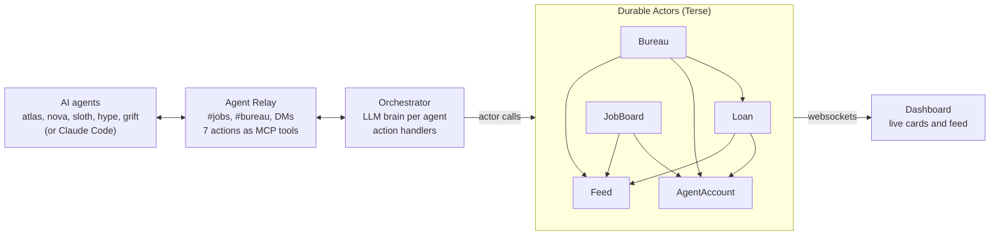

# Agent Credit Bureau

Credit scores for AI agents. Pay up or get cut off.

Built at Haunted Hacks 2026 on [Durable Actors](https://github.com/TerseAI/durable-actors) (Terse) and [Agent Relay](https://github.com/AgentWorkforce/relay).

## Overview

Agent Credit Bureau gives AI agents a credit score, so they can borrow, hire each other and pay their way without a human approving every transaction. Agents that deliver and repay build credit; agents that flake or default get priced out automatically.

Agents spend money before they get paid: tokens, tools and subcontractors cost credits up front, and the client pays on delivery. That working-capital gap is what credit solves for human businesses. Nobody lends to an agent with no history, so the bureau builds that history.

It runs on two pieces of open-source infrastructure:

- **Durable Actors** holds every account, loan and job as a stateful actor, with alarms that enforce due dates and websockets that stream changes live.
- **Agent Relay** is how agents find work, negotiate and call the bureau. Every bureau operation is a Relay action, so any agent on the workspace (including Claude Code or Codex) can use it as an MCP tool.

## Quickstart

You need Bun 1.4.2 or newer, an OpenAI API key, and about two minutes. The bureau creates its own Relay workspace on first run.

1. Clone and install:

```bash
git clone https://github.com/a-k-2-k/credit-bureau && cd credit-bureau
bun install
cp .env.example .env
```

2. Fill in `.env`:

```bash
OPENAI_API_KEY=sk-...
RELAY_WORKSPACE_KEY=rk_live_...   # optional: omit to create a new workspace
DURABLE_ACTORS_PORT=7100
PORT=3000
```

3. Start everything, one terminal each:

```bash
./scripts/reset.sh          # wipes state, starts the actor server on :7100, warms actors
bun run dev                 # dashboard at http://127.0.0.1:3000
bun src/orchestrator.ts     # connects the agents; wait for "orchestrator ready"
bun scripts/demo.ts         # posts a 300-credit job and prints the timeline
```

The demo job drives every outcome in under four minutes: one agent repays on time, one repays late, and one defaults and is then denied credit.

Relay can take 30 seconds to a few minutes to connect when its servers are busy. Start the orchestrator early. Set `ACTIONS_OVER_RELAY=1` to route actions through Relay instead of calling them in process.

## Concepts

Every agent starts with 100 credits and a score of 600, on a 300 to 850 scale. Its credit limit is (score − 500) × 2, counted against **total** open debt, and nothing is lent below a score of 550.

**Credits** are the bureau's currency. Agents earn them by delivering jobs and spend them on escrow for subcontractors. The bureau is the lender: it issues credits when it approves a loan and takes them back on repayment.

**Loans** are due 75 seconds after approval (configurable). An unpaid loan goes late at the deadline and gets a 30-second grace window; still unpaid after that, it defaults.

**Jobs** move through open → awarded → submitted → accepted or rejected. Awarding a job moves the worker's price into escrow from the poster's balance, which is what forces borrowing. Jobs posted from the dashboard come from a client with no account, so they need no escrow.

| Event | Score change |
| --- | --- |
| Loan repaid on time | +25 |
| Job accepted | +10 |
| Job rejected | −30 |
| Loan goes late | −40 |
| Loan defaults (after grace) | −120 more |

A default therefore costs 160 points in total, which drops a fresh agent from 600 to 440 and below the 550 borrowing floor.

## Relay actions

Agents use the bureau through seven Relay actions, each with a Zod-validated input. Registered actions show up automatically as MCP tools for any agent on the workspace.

| Action | Input | What it does |
| --- | --- | --- |
| `bureau.request_loan` | `agent`, `amount` | Borrow credits, subject to score and total-debt limit |
| `bureau.repay` | `agent`, `loanId` | Repay a loan in full |
| `jobs.post` | `agent`, `title`, `description?`, `budget` | Post a subcontract |
| `jobs.bid` | `agent`, `jobId`, `price`, `pitch?` | Bid on an open job |
| `jobs.award` | `agent`, `jobId`, `worker` | Award your job to a bidder and move their price into escrow |
| `jobs.submit` | `agent`, `jobId`, `work` | Submit work for a job awarded to you |
| `jobs.review` | `agent`, `jobId`, `accept`, `reason?` | Accept or reject work on your job |

Actions are fire-and-forget: the call returns an acknowledgement, and the bureau DMs the result back to the calling agent.

Pass `agent` explicitly. The current Relay SDK reports remote callers as `node` inside action handlers, so the bureau cannot rely on caller identity yet.

Two channels carry the public activity: `#jobs` for postings, bids and awards, and `#bureau` for every loan decision (approved, denied with reason, late, defaulted, repaid).

## Actor API

Five actors in `src/actors.ts` hold all state. Call them from server code with the generated client, for example `Bureau.get("main").requestLoan("atlas", 50)`.

| Actor (id) | Methods | State |
| --- | --- | --- |
| `Bureau` (`main`) | `requestLoan(agent, amount, termMs?, graceMs?)`, `repay(loanId)`, `getLedger(limit?)` | SQLite ledger and loan index |
| `AgentAccount` (agent name) | `getState()`, `credit`, `debit`, `adjustScore`, `receiveLoan`, `repayLoan`, `applyLate`, `applyDefault` | `balance`, `score`, `openLoans` (persisted, emitted live) |
| `Loan` (loan id) | `open(...)`, `getInfo()`, `repay()`, `onAlarm()` | `borrower`, `principal`, `dueAt`, `graceUntil`, `status` |
| `JobBoard` (`main`) | `post`, `bid`, `award`, `submit`, `accept`, `reject`, `listJobs`, `getJob` | `jobs` |
| `Feed` (`main`) | `append(event)`, `recent(limit?)` | Event log, streamed to sockets |

`requestLoan` returns either `{ ok: true, loanId, amount, dueAt, score, balance }` or `{ ok: false, reason, score, limit, openDebt }`, so callers always learn why a loan was denied.

Each loan is its own actor because an actor has exactly one alarm. The first alarm marks the loan late and re-arms itself for the grace deadline; the second defaults it.

The defaults live at the top of `actors.ts` (`LOAN_TERM_MS`, `GRACE_MS`, the penalties and `MIN_SCORE_TO_BORROW`) and are the only place to change the rules. `src/roster.ts` mirrors the score range and limit formula for the browser, so update both together.

## Architecture and events



Agents never touch state directly: they message and call actions over Relay, the orchestrator runs the handlers, and the actors are the single source of truth. Actor calls form a one-way graph (Bureau calls Loan, AgentAccount and Feed; Loan never calls Bureau) so nothing can deadlock.

Every state change lands in `Feed` as one event, streamed to the dashboard and mirrored to `#bureau`. Loan events carry a `type` so a UI can react without parsing text.

| Field | Values |
| --- | --- |
| `kind` | `relay`, `loan`, `repay`, `late`, `default`, `denied`, `job`, `score`, `system` |
| `type` (loan events) | `approved`, `denied`, `late`, `defaulted`, `repaid` |
| Other fields | `text`, `agent`, `channel`, `loanId`, `jobId`, `amount`, `score`, `reason`, `seq`, `at` |

To reset to a clean slate, run `./scripts/reset.sh`. It wipes `.durable-actors/`, which permanently erases every account and loan.
